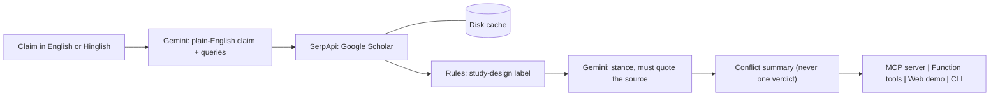

<div align="center">

# Pramaan &nbsp;·&nbsp; प्रमाण

### Ask an AI agent about a health claim, in English or Hinglish, and see *what the evidence actually says* and *where it disagrees*.


**SerpApi India Hackathon 2026** &nbsp;|&nbsp; Track: **Open-Source Integrations**

[Quick start](#-quick-start) · [How it works](#-how-it-works) · [Honest by design](#-honest-by-design) · [Evaluation](#-evaluation) · [Limitations](#-limitations)

</div>

<!-- Add a screenshot or short GIF of the web demo here, e.g. docs/demo.gif, then uncomment:

-->

---

## 🩺 Why Pramaan?

*Pramaan* (प्रमाण) means **proof** or **evidence** in Hindi.

Health claims spread faster than they can be checked: home remedies, supplement promises and "doctor said" forwards, often written in Hinglish and passed along by people we trust. When an AI agent searches for them, the results hide three things:

| | The problem | What Pramaan does about it |
|---|---|---|
| 🔬 | **Study quality is invisible.** A meta-analysis, a rat study and a blog look the same in a result list. | Labels each result's study design, or says **unclassified** when it cannot tell. |
| ⚖️ | **Disagreement is hidden.** Evidence is often mixed, but a generated answer sounds confident. | Reports whether credible sources **conflict**. It never gives a single verdict. |
| 🗣️ | **Language gets in the way.** "haldi se sugar control hoti hai" does not map to scientific vocabulary. | Normalizes English or Hinglish into a plain claim and standard search terms. |

---

## ✨ What it does

One agent tool: **`check_health_claim`**.

1. **Understands the claim.** English or Hinglish in, a plain-English claim and up to 2 search queries out (Gemini).
2. **Finds the literature.** Searches Google Scholar through **SerpApi** (cached on disk, so repeats are free).
3. **Labels the study design.** Systematic review, RCT, observational or pilot, preclinical (animal or lab), narrative review, book, or *unclassified*. Preprints are flagged.
4. **Judges each source's stance.** Supports, opposes or insufficient, and it **must quote the source text** or the call is downgraded.
5. **Summarizes conflict.** `conflict`, `supported`, `opposed`, `preclinical_only_support` or `insufficient`. Animal and lab studies never count toward human-evidence conflict.

---

## 🧭 How it works



**How SerpApi is used:** the `google_scholar` engine supplies titles, snippets, venue, year, citation counts and result type for every claim. Responses are cached, so re-checking a claim costs no credits.

---

## 🚀 Quick start

```bash
git clone https://github.com/<your-username>/pramaan.git
cd pramaan

python -m venv .venv
source .venv/bin/activate          # Windows PowerShell: .venv/Scripts/Activate.ps1

pip install -e .

export SERPAPI_API_KEY="..."        # Windows PowerShell: $env:SERPAPI_API_KEY="..."
export GEMINI_API_KEY="..."         # Windows PowerShell: $env:GEMINI_API_KEY="..."

pramaan --check "haldi se sugar control hoti hai"
```

Python 3.10 or newer. **Never commit your keys.** Use environment variables only (`.env.example` lists the names).

> No Gemini key? Pramaan still runs: it uses your claim as typed and marks every stance *insufficient*, so you can try the pipeline offline-ish.
> If Gemini reports a model-not-found error, set `GEMINI_MODEL` to a model listed in Google AI Studio.

---

## 🔌 Use it four ways

| Interface | How |
|---|---|
| **MCP server** (Claude Desktop, MCP Inspector) | `python -m evidence_tools.mcp_server`, see [`examples/README.md`](examples/README.md). Tools: `check_health_claim`, `label_study_design`. |
| **Web demo** | From the repo root run `pramaan-web`, then open http://127.0.0.1:8000 |
| **CLI** | `pramaan --check "Turmeric lowers blood sugar."` |
| **Any function-calling framework** | `evidence_tools/adapters/function_tool.py` provides `TOOL_SCHEMAS` and `run_tool` |

### What a result contains

| Field | Meaning |
|---|---|
| `claim` | What was understood: plain-English claim, language, queries used |
| `sources[]` | Per source: title, link, year, citations, **study design**, **stance**, **quoted evidence** |
| `summary.status` | `conflict` · `supported` · `opposed` · `preclinical_only_support` · `insufficient` |
| `unclassified` | How many sources had no visible study design |
| `disclaimer` | Always present: not medical advice |

---

## 🛡️ Honest by design

- **"Unclassified" is a feature.** If the design is not visible in the title or snippet, Pramaan says so instead of guessing, and publishes the unclassified rate.
- **No quote, no stance.** A supports or opposes call without a verifiable quote is downgraded to insufficient.
- **Transparent rules.** Every study-design label records whether it came from the title, the snippet or a type field.
- **Conflict over verdict.** Showing disagreement is the point.
- **Animals are not people.** Preclinical support alone is flagged as `preclinical_only_support`.
- **Not medical advice.** This tool labels and compares evidence. It does not diagnose or recommend treatment.

---

## 📊 Evaluation

`python evaluation/run_eval.py run` checks **20 claims: 10 topics, each in English and in Hinglish**, and writes `evaluation/RESULTS.md` with:

- the **unclassified rate**,
- **English-vs-Hinglish consistency** (the same claim in both languages should get the same status),
- and, from hand labels, **status accuracy** and **stance accuracy**.

Numbers appear in [`evaluation/RESULTS.md`](evaluation/RESULTS.md) only after a real run. Nothing there is written by hand.

---

## 📋 Status

| Part | State |
|---|---|
| Scholar retrieval, cache, classifier, normalization, stance, conflict summary | ✅ Built, unit-tested (fakes and real Scholar titles) |
| MCP server, function-tool adapter, web demo, CLI | ✅ Built, tested against fake backends |
| Live runs on real SerpApi and Gemini | ⏳ See `evaluation/RESULTS.md` |
| Google News and Google Search retrieval | 🗺️ Not built (roadmap) |

---

## ⚠️ Limitations

- Scholar returns a **title and a short snippet, not an abstract**, so many results have no visible study design, and those are often the human studies that matter.
- Stance from snippets is weak, and "no effect" is counted as *opposes*.
- Citation counts are shown but are not proof of consensus.
- Only Google Scholar is used so far.
- Accuracy is reported only where it was measured on hand-labeled data.

---

## 🔍 Gap and related work

In [medical-mcp](https://github.com/JamesANZ/medical-mcp), results are tagged by study type with rules over the title and abstract, and its README says the labels are not verified. We searched its code and found no contradiction detection and no non-English claim handling. SerpApi's own MCP server returns raw search data and leaves interpretation to the agent. We have **not** audited every related tool, so this is a gap relative to what we checked, not proof that nothing else exists.

Also relevant: a published [multi-agent pipeline for tobacco misinformation](https://www.ncbi.nlm.nih.gov/pmc/articles/PMC12757325/) and [GutCited's study-quality grading](https://gutcited.com/methodology/).

---

## 🗺️ Roadmap

- Google News and Google Search retrieval for public-claim context
- Abstracts from PubMed for better design and stance on the top results
- More Indian languages beyond Hinglish
- Adapters for specific agent frameworks

---

## 🗂️ Project structure

```
pramaan/
├── README.md  LICENSE  pyproject.toml  requirements.txt  .env.example  .gitignore
├── evidence_tools/
│   ├── cache.py          disk cache (0 credits on repeats)
│   ├── scholar.py        SerpApi Google Scholar client + parser
│   ├── classify.py       study-design classifier (+ unclassified)
│   ├── llm.py            Gemini JSON helper (cached, offline-safe)
│   ├── claims.py         normalization, grounded stance, conflict summary
│   ├── pipeline.py       check_claim() + result_to_dict()
│   ├── mcp_server.py     MCP server (the integration)
│   ├── web.py            local web backend (standard library)
│   ├── cli.py            command line
│   └── adapters/function_tool.py   framework-agnostic tool schemas + dispatcher
├── web/index.html        demo frontend
├── evaluation/           claims.csv, run_eval.py, RESULTS.md (generated)
├── examples/             Claude Desktop config example, demo claims
├── docs/                 VIDEO_SCRIPT.md, SUBMISSION_CHECKLIST.md
└── tests/                classifier, claims, MCP, web, adapter, eval, fixtures
```

Run the tests: `python -m unittest discover -s tests -v`

---

## 🤖 AI disclosure

Built with AI assistance: **Claude** for design and code drafting, and **Gemini** at runtime for claim normalization and stance. Study-design labels come from transparent rules, not an LLM.

## 📄 License

MIT. See [LICENSE](LICENSE).

<div align="center">

*Pramaan labels and compares evidence. It is not medical advice. Talk to a qualified clinician about your health.*

</div>